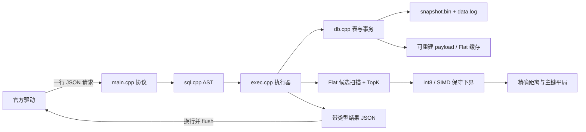

# MiniVectorDB 技术报告与正式评测复盘

报告日期：2026-11-12。仓库：[iamSttt/seekdb](https://github.com/iamSttt/seekdb)，分支 `2026-competition-round2`。

本报告根据实际源码、已归档的复验记录和本次登录后读取的正式结果编写。最新已评测提交为 `ee299adb296a2922d01982aa6c5707d37e767b41`，其运行核心源于 `e8534416dcef2af64847330ffedb12831e45885d`。本轮在此基础上整理仓库、删除无用模块与对话材料；不会把旧正式成绩冒充清理后提交的新成绩。

## 本次正式结果

来源：[OceanBase 提测记录](https://open.oceanbase.com/train/TestRecord?questionId=600081)。读取的是 2026-11-12 19:52（北京时间）提交的成功详情，未发起新评测。脱敏后的逐字段记录见 [formal-ee299adb-20261112.json](../validation/formal-ee299adb-20261112.json)。

| 项目 | 平台显示 | 解读 |
| --- | --- | --- |
| MySQL 正式用例 | 通过 | 准入通过，不计排名分 |
| 性能原始指标 E | **3014.419039** | 本次实际性能结果；不是最终排名积分 |
| Agent Prompt 原始分 | `—` | 本项未参与排名 |
| 任务/用例汇总 | 执行成功，成功1、失败0 | 不能解读成只有一条 SQL，也不能替代性能分项 |

Prompt 提示为“Prompt结果无效、待复核、超出平台0–100范围或缺少材料摘要，本项不参与排名；未截断或换算本地分数。”该提示列出多种可能，不能据此断言某个字段、贡献比例或原始分超界是唯一原因。页面没有评审明细、材料摘要、分项 T/B/M、隐藏用例或日志下载入口。此次仍没有证据证明 Prompt 无效问题已解决。

| 已评测提交 | 时间（北京时间） | MySQL | 性能 E | 说明 |
| --- | --- | --- | ---: | --- |
| `fa562be` | 11-10 21:33 | 通过 | 2180.028190 | 较早正式基线 |
| `ff9c6bf` | 11-11 12:23 | 通过 | 2708.402710 | 历史较高结果 |
| `2d1dc24` | 11-11 16:20 | 通过 | 2336.046455 | 与 ff9c6bf 运行源码相同、仅材料变化；波动不能归因运行代码 |
| `ff6a3bd` | 11-12 07:13 | 未通过 | 未产出 | JSON response timeout；旧入口复现见第8节 |
| `ee299adb` | 11-12 19:52 | **通过** | **3014.419039** | 本次结果 |

较2708.402710提升 **11.298775%**，较2336.046455提升 **29.039345%**。这证明本次整套提交获得了更高的 E，但不证明每项修改都提速，也不揭示写入/查询/内存/IO各自贡献。旧公式脚本输出0到1范围，而平台E处于千位量级，缺少可验证换算关系，已从当前工具中移除，避免误预测。不能由3014.419039推算排名积分或承诺下一次6000。

以下源码行号以清理起点 ee299adb 为准，保留的运行源文件字节不变。清理记录与实际复验结果见第10、11节。

## 1. 实现定位与系统边界

当前实现是 Linux 上的单进程 C++17 数据库，默认通过 stdin/stdout JSONL 协议服务逐条 SQL 请求。它不是 OceanBase 完整内核，也不监听 MySQL TCP 端口；赛事所说的 MySQL 正式用例，是对规定 SQL 子集语义及响应的准入检查。公开协议明确不使用 MySQL 网络协议。

正式路径包括：`main.cpp` 的 JSON 外壳 → `sql.cpp` 的词法/语法分析 → `exec.cpp` 的执行与结果生成 → `db.cpp` 的表、事务、WAL、恢复与索引管理。向量搜索由 `flat_index.cpp`、`distance.h`、`quantized_bound.h` 协作执行。JSON 编解码依赖仓内 `third_party/json.hpp`；数据库与索引操作没有借用 SQLite、RocksDB、Faiss、VSAG 或 HNSWlib。

系统目前是一次处理一个请求、一个活动事务的模型。查询/解析线程池仅并行某一条语句内部的纯计算，不提供并发客户端、MVCC、锁管理或多会话隔离。数据目录也不适合多个进程同时写入。

## 2. 模块职责与是否必要

| 模块 | 当前用途 | 清理判断 |
| --- | --- | --- |
| 根 `Dockerfile`、`.dockerignore` | 正式镜像构建、入口及构建上下文 | 必须保留 |
| `minivec/src/main.cpp` | JSONL 握手、请求解析、id 保真、响应/退出 | 必须保留 |
| `sql.{h,cpp}`、`value.{h,cpp}` | SQL AST、字面量、UTF-8 比较及类型 | 必须保留 |
| `exec.{h,cpp}` | DDL/DML/SELECT 调度、排序、JSON 数据编码 | 必须保留 |
| `db.{h,cpp}` | 表、主键目录、语句/事务回滚、WAL、快照、恢复、索引生命周期 | 必须保留 |
| `flat_index.{h,cpp}` | 当前实际使用的 Flat 索引与标量 posting cache | 必须保留 |
| `distance.h`、`quantized_bound.h` | 精确距离、认证剪枝、SIMD | 必须保留 |
| `query_pool.h`、`parse_pool.h` | 单语句内部并行 | 被当前路径引用，必须保留 |
| `result_sort.h` | 大结果外排与有限路归并 | 必须保留 |
| `third_party/json.hpp` | JSON 库 | 必须保留 |
| `vector.{h,cpp}` | 早期独立 IVF/向量实验 | 未被当前执行器/存储调用；已连同专属测试移除 |
| `crc32.h` | 旧独立 CRC 实验 | 已核实仅专属实验测试引用，二者均已移除；运行中的 `db.cpp` CRC 保留 |
| 官方 `STDIO_PROTOCOL.md`、`protocol_check/`、`mysqltest/` | 协议与公开测试契约 | 应保留原样 |
| 有效单元/恢复/交互/TopK 测试 | 保护运行正确性 | 应保留；不要因为不进入镜像就统称无用 |
| `conversation.json` 两份及专属材料生成/校验工具 | 历史 Agent Prompt 提交材料 | 已按用户要求移除，CI/文档依赖同步清理 |
| 大量历史评测原始输出、旧 CI 脚本 | 历史取证 | 当前树已删除，关键结论归并本报告，历史由固定 Git/CI 链接追溯 |

清理前源码确认：`rg` 对运行目录检索 `IvfIndex`、`exact_topk`、`vector.h`，匹配仅在 `vector.cpp` 与 `vector.h` 自身。正式源构建虽用 `src/*.cpp` 将其纳入编译，但没有执行引用；删除这组实验不应改变正式查询算法。仍需做实际构建/测试，不能只凭搜索宣告发布成功。

## 3. 构建和 JSONL 契约

根 Dockerfile 固定 GCC 13.3.0 bookworm 的镜像 digest，静态链接、`-O3 -std=c++17 -fno-math-errno -pthread`，使用 scratch 作为运行层。入口为 `/minivec --data /data`。没有运行时下载、apt/pip 或网络服务。构建阶段 smoke 比较精确的 ready/shutdown 两行输出；它是基础入口检查，完整交互仍由独立 Session 测试验证。

`main.cpp:395` 解析参数，默认 `protocol=jsonl`；`Database::open()` 完成快照/WAL恢复以及持久索引定义重建后才输出 `{"type":"ready"}`（`main.cpp:421–437`）。每个完整物理行进入 `json_request()`，要求对象、id、字符串 op；execute 还要求字符串 SQL 和 exact/ann 模式。请求必须整行严格解析成功后才执行，避免非法 UTF-8 或重复键在半解析状态下产生写入。

简单 ASCII 包络可走快速解析；含转义/非 ASCII 或复杂字段则回退严格 JSON 解析。数值 id 不经过浮点重编码，`raw_request_id()` 在严格验证后保留其原始 JSON 值，避免 BIGINT 或更宽整数被改写。结果 `ok` 为布尔，错误码为非空字符串；SQL 数据保持整数、字符串和向量数组类型。源码：`main.cpp:138–276`、`293–393`。

`emit_json_text()` 执行 fwrite、换行和 fflush，并检查失败（`main.cpp:278`）。stdout 仅协议报文，日志走 stderr。收到 shutdown 时，先回滚未提交事务，再关闭数据库、回成功、flush 并退出。EOF 遇到未以换行结束的残缺帧不执行该帧，返回 invalid_request（`main.cpp:439–465`）。分片 UTF-8 字节在 pending 缓冲聚合后才解码。

官方配置为启动 120 秒、单请求 60 秒、单用例 600 秒；CPU 2、内存 2 GiB、pids 128，最大响应 16 MiB。`protocol_check/config.json` 的错误码映射目前是空对象，不能把实现选取的 MySQL 风格数值字符串宣称为已获完整官方认可的映射。

**需要纠正旧文档的边界：正式 JSON 响应目前不是端到端分块流式输出。** `exec.cpp:409–440`、`451–498` 把 JSON 行追加进一个输出 string，`main.cpp:376–383` 再添加 id/ok 并输出。旧 TSV 分支才在 64 KiB 后交给 sink。外排降低排序工作集，却不会消除完整 JSON 响应占用的内存。输入 pending、AST、单条巨型 SQL 也没有统一小型硬上限。官方 16 MiB 响应限额是判题器限制，不代表当前程序所有路径已主动受该限额约束。

## 4. SQL 与类型语义

解析器支持 CREATE TABLE、DROP TABLE、INSERT 多行及显式列序、SELECT 列投影/星号、UPDATE、DELETE、AND 条件比较、单个 ORDER BY 表达式、LIMIT、CREATE VECTOR INDEX、BEGIN/COMMIT/ROLLBACK、SHOW TABLES。支持行内或表级单列 PRIMARY KEY；BIGINT、INT、INTEGER 都映射当前整数类型。VARCHAR(n) 的解析范围是 1..65535，VECTOR(n) 是 1..65536。见 `sql.cpp:724–840`、`873–961`、`1008–1114`。旧 README 的“只有 inline 主键”并不准确。

每表要求一个整数主键、至多一个向量列。主键目录是 `unordered_map<int64_t,size_t>`，等值主键查询/UPDATE/DELETE 可直接定位行槽（`db.cpp:1284`、`1417`、`1485`）。WHERE 的多个条件必须全部满足，向量检索先过滤再算距离。字符串按 Unicode 码点长度/顺序处理，不能用 UTF-8 字节数替代 VARCHAR 字符长度。向量存为有限 float32，维度与声明严格匹配。

`L2_DISTANCE()`/`L2_DIST()` 可在投影或排序中使用。排序内部采用平方距离，最终距离投影返回 sqrt；这避免给所有候选开方。距离相等时始终主键升序，即便 ORDER BY DESC 也是如此（`exec.cpp:400–426`）。BIGINT 比较保留 64 位整数，不经 double。主键 UPDATE 明确拒绝，NULL、AUTO_INCREMENT、JOIN、聚合、OR、子查询、多个 ORDER BY、OFFSET 等不在当前实现子集内。不要把“通过公开 MySQL 用例”表述成“兼容通用 MySQL”。

并行 INSERT 仅将字面量转换分给 `ParsePool`，语法扫描和输出行顺序仍由调用线程管理。池默认最多两个计算参与方（主线程+一个工作线程）；显式环境变量可改 1..8。错误按切片顺序重抛，不允许工作线程直接写表或 WAL。`sql.cpp:909–953`、`parse_pool.h:27–89`。

## 5. 表存储、内存预算和派生结构

`Table` 持有行槽数组、删除标记、主键到槽映射，以及可选 payload store（`db.h:32–49`）。删除使用 tombstone，主键目录去除可见行；Undo 恢复相应状态。payload store 是 `/data/.payload-XXXXXX` 的临时匿名文件，创建后立即 unlink；它并非持久事实来源，而是可以从快照与 WAL 重建的缓存。

单表 payload 大约超过 32 MiB 后落盘，数据库全局 resident payload 预算为 64 MiB，超出时选择最大 resident 表落盘（`db.cpp:314–347`）。在真正释放行向量前清掉其借用索引，防止跨表触发预算清理时留下悬空指针。主键、槽、删除标记、payload offset、Undo 元数据仍留在内存，且随记录数增长；预算不等于进程始终小于固定常数。

resident FlatIndex 只保存借用的 `const float*`、PK、slot；向量仍由表行拥有，避免重复 4×N×D 字节的数据副本（`flat_index.h:10–20`、`flat_index.cpp:98–115`）。所有改变可见数据的操作、回滚、spill、drop、close 都必须失效该结构。磁盘表则生成固定记录布局的临时 Flat 文件，复制 PK/slot/向量，通过有界缓冲顺序扫描。索引定义是持久状态，物理索引可重建，启动 ready 前重建所需索引。

共享 resident-index 预算为 16 MiB（`db.cpp:1774–1794`），另有最多 1 MiB 范数排序临时元数据，最多 1 MiB 单列 BIGINT posting cache、最多 4 MiB int8 code 条件预算。Flat 构造器仍按 `(4*dimension+16)*count` 估算是否 resident，这是从复制向量时代保留的保守准入方式；虽然实际持有指针，较大索引仍可能过早落到磁盘。能否改用真实元数据预算是可研究方向，必须同时限制量化/posting/临时构建峰值。

`UPDATE` 为限制长事务保存旧行像的内存，第一次实际更新 resident 表前会主动 spill（`db.cpp:1292–1305`）。由于执行器给自动提交语句也开启内部事务，小表的一次 UPDATE 也可能把后续向量查询转到磁盘路径。该策略更保守，但更新—查询混合负载可能因此慢很多；适合做后续专门 profile，不能凭直觉移除其 Undo 内存保护。

大排序采用 8 MiB run 预算、最多 16 路且根据最大行宽进一步缩小 fan-in 的外部归并（`result_sort.h:22–136`）。单条巨大行仍可能超过该预算，最终 JSON 响应也另占空间。普通小 K TopK 只留排序键与 PK，再按胜出 PK 取投影，不在堆中复制整行。

## 6. 事务、WAL 和恢复

持久事实来源是 MVS1 格式的快照与 `data.log` WAL。WAL 记录包含长度、CRC、类型、事务标志、LSN 及载荷。DDL、DML、索引定义都经同一日志；不存在先单独把未提交 catalog 变成权威状态的路径。`db.cpp:66–99`、`205–276`、`992–1009`。

数据库在内存中立即应用事务变更，同时记录逆向 Undo，因此可读到自身尚未提交写入。每条修改语句保存 Undo/WAL 边界；失败只撤回本条语句的后缀，保留显式事务之前成功语句。无显式事务时，`begin_statement()` 创建内部事务，成功结束时 COMMIT。COMMIT 写标记、flush WAL、fdatasync 成功后才返回成功。事务失败可保留供重试或 rollback，不把缓冲增长误当作持久化成功。见 `db.cpp:1516–1573`、`1637–1703`，`exec.cpp:723–744`。

WAL 用约 1 MiB staging buffer 减少细碎 write。`wal_bytes_` 是逻辑末尾，`wal_flushed_` 是物理已写末尾，两者差对应尚在内存的后缀；flush 允许处理短写，并记住实际已写数量。回退边界还在缓冲区中时仅裁剪 buffer，已经进入文件时 ftruncate 后 fdatasync（`db.cpp:1104–1154`、`1637–1660`）。这是最近 UPDATE/DELETE 错误传播修复的关键：必须检查 append_wal 返回值，不能仅看逻辑长度增长。

文件打开使用 O_APPEND，尝试预分配 8 MiB 且保持逻辑长度不变；成功同步后对新增已持久区间给出 POSIX_FADV_DONTNEED，降低 page-cache 占用。预分配和 fadvise 是性能提示，不能代替同步协议，也没有把性能提示失败冒充数据库错误。

恢复先验证快照 CRC，再通过有界读取解码。WAL 遇到完整 COMMIT 才把对应事务应用到表；待提交事务仅记起始 offset，提交后重读其记录，避免把整个大事务常驻内存。CRC 不匹配、残缺记录或未提交后缀不能成为已提交数据；修复尾部后可继续新写入。见 `db.cpp:1921–2110`、`2114–2344`。

WAL 约超过 64 MiB 会在非活动事务状态触发 checkpoint：写临时快照、校验/刷新、fsync、rename、目录 fsync 后再截断 WAL；快照记录 LSN，可跳过已覆盖记录（`db.cpp:2348–2454`）。checkpoint 开销集中在写入时段，达到阈值前后的耗时不能混为相同写入负载。磁盘/内存错误路径还有尚未注入的类型，公开测试通过不等于任意掉电点和底层设备故障都已穷尽。

## 7. 向量检索与正确性优先的加速

默认 exact 与 ann 都做精确候选扫描；当前实现的加速手段包括减少距离计算、减少数据复制、减少间接调用与可选双线程。默认配置下可以用 exact 结果对照 ann，但不能把部分簇实验路径的召回也算作已认证。

距离函数并非普通 float SIMD 累加。`distance.h:91–167` 先利用 long double 做快速精确舍入认证；当误差区间无法证明最终 double 一致时，回退到十个 64 位 limb 的整数累加。有限 float32 是 2^-149 的整数倍，其平方和可用统一 2^-298 标度无损累加，最后一次舍入至 binary64。该语义对极大/极小值、近似平局、不同扫描顺序保持一致，但每个真正进入精确核心的候选成本明显高于普通 float 点积。

查询最多分三层工作：

1. 可用 int8 code 时，计算整数平方距离，用向外舍入三角不等式界证明候选严格劣于当前第 K 名后直接丢弃。量化值不直接作为排名距离。
2. SSE2/AVX2/AVX512 的 float 距离估算只生成保守拒绝界；只在严格证明更远时跳过，等距和不确定值进入精确路径。
3. 剩余候选调用精确 distance_squared，并按 `(distance, PK)` 的全序更新堆。

在异常浮点环境、非有限中间值、不合适维度、无法编码查询或可选存储分配失败时，应退回原精确路径。SIMD 用运行时特性派发，AVX512 选择也核验其短分支所需 AVX2。核心条件见 `distance.h:169–389`、`quantized_bound.h:146–198`。本轮未使用 `-ffast-math`，不宜为了微小吞吐改变认证所依赖的浮点模型。

建索引时对有限规模 resident 行按向量范数排序（最多 1 MiB 辅助数组）。这只改变扫描先后，尝试尽早收紧 TopK 半径，不删候选。单个 BIGINT 等值过滤可使用按值分组的 posting ordinal，直接遍历借用向量；AND 更多条件仍逐行检查剩余 predicate（`db.cpp:1837–1915`）。滤后计算距离，避免后过滤导致 TopK 数量/正确性错误。

查询 fan-out 仅覆盖无过滤、resident、非近似、升序、1≤K≤1024 的路径（`exec.cpp:527–617`）。两半各有自己的堆和阈值，再合并两半 TopK；各半局部前 K 的并集一定含全局前 K。工作线程异常和调用方异常都要等两半结束后才能重抛，避免栈上闭包被仍运行的线程访问。创建线程失败时顺序执行两半，保留异常语义。工作线程屏蔽 SIGTERM/SIGINT，避免中断主线程读输入的信号被后台线程消耗。

策略自测 200 次唤醒握手中位数，用候选数估算扫描收益；仅预测节省至少 15 μs 且候选数至少 1024 时适应性开启。该估算采用 10 ns/row 常量，并未按维度/量化拒绝比例精确建模。**实际校准由 `exec.cpp:727` 在第一条 SQL 时触发，不是 ready 之前完成。** 这对严格逐请求时延统计需要单独说明。`MVDB_QUERY_THREADS=2` 可强制路径供回归，不代表每台评测机器都应强制双线程。

可选的 `MVDB_ANN_PROBE_PERCENT<100` 会在 resident 大表上建立一层粗分区，ann 请求只扫若干簇；默认100意味着不建也不查该结构。源码所称“k-means两轮”实现存在缺口：第一轮累计 sums/sizes 后没有用它们更新 centroids（`flat_index.cpp:185–206`），实际还是固定种子质心的分配，不能按已完成 k-means 训练解释。该分支在本轮公开测试与性能结果中未启用，不能宣称达成某召回门槛或直接启用冲分。若未来保留此实验，应先修复质心更新并测完整召回-耗时曲线。

## 8. 已有证据能证明什么

最近运行核心为 `e8534416dcef2af64847330ffedb12831e45885d`；`c0cc565...` 归档报告，`ee299adb...` 修订材料，未替换这套运行核心。清理仅删除无生产调用的独立 vector/CRC 实验，保留的运行源码、第三方库、根 Dockerfile 与官方契约均保持原字节。

| 检查 | 已记录结果 | 证据边界 |
| --- | --- | --- |
| 根 Dockerfile 实际构建 | CI 43134391008 成功，镜像 sha256:76d581ff6f4e21835a9f0778a030d33704d31e6e8afbb9001247b18baa0e5e82 | 对 e853 的构建结果；清理后仍需重构建 |
| 官方公开 JSONL | Docker 与源码均20/20 | 无隐藏用例，无正式 E |
| 活 stdin 交互 | ready时序、逐请求错误后继续、分片UTF-8、shutdown退出、重启 | 不是只用文件预喂所有输入的 smoke |
| JSON专项 | 7组通过 | 类型、事务、非法输入、崩溃、模式、分片、并行INSERT错误、旧入口包含在各组 |
| 查询正确性 | TopK 普通/强制双线程、独立精确oracle、平局等 | 默认 ANN 等同 exact；不覆盖显式部分簇召回 |
| 内存/线程故障 | 查询池异常/创建失败、跨表spill、ASan/UBSan | ASan leak detection 为长驻线程池关闭；不是全部资源泄漏的证明 |
| WAL staging | 8个专项普通与ASan/UBSan通过 | 短写、提交头/体部分写、重试/close-reopen等；未直接注入 fdatasync 返回失败/分配失败 |
| SIGKILL | 已提交恢复、未提交DDL不生效 | 与close/reopen专项分开记录，不相互冒充 |

CI 链接：[最终运行复验](https://github.com/iamSttt/seekdb/actions/runs/43134391008)，[并行安全复验](https://github.com/iamSttt/seekdb/actions/runs/43132750770)，[JSON入口恢复复验](https://github.com/iamSttt/seekdb/actions/runs/43129998304)。历史归档可在[清理前验证目录](https://github.com/iamSttt/seekdb/tree/ee299adb296a2922d01982aa6c5707d37e767b41/validation/raw)查询；当前树只保存本轮结果和清理清单。删除归档未改写 Git 历史。

ff6a3bdb 的旧正式失败为 JSON response timeout。确切旧入口没有主动 stdout JSON ready，只在 stderr 输出提示后等 SQL，判题器却在发第一请求前等 ready，构成相互等待。精确源码复现是进程仍活着、stdin开着、stdout零字节且Session超时。后来的UTF8、线程寿命、跨表spill、WAL错误修复是另外发现的问题，不能倒推成该次正式失败的官方原因。

WAL故障对照中，原385在UPDATE/DELETE短写后误报成功；恢复写入空间后COMMIT/reopen仍恢复一致数据。因此证据证明“错误未及时报告”，没有证明“已确认COMMIT数据丢失”。修复版本三种DML均报告失败，并回退本语句保留前序语句。写报告应保持这一准确区分。

## 9. 性能证据与改进优先级

最后一轮 385 对 e853 是安全修复配对验证，不是性能大改。三个seed、10k行×128维、exact/ann各1000查询下，baseline/candidate 查询耗时比率中位0.994693，候选耗时约多0.53%；写入中位比率0.899100，候选耗时约多11.22%。其他独立写入profile方向不一致，durable I/O和调度方差尚未隔离，不能隐去慢样本，也不能把这几次结果唯一归因为两处错误检查。详见[最终安全修复配对分析](https://github.com/iamSttt/seekdb/blob/ee299adb296a2922d01982aa6c5707d37e767b41/validation/verify-final-20261112-performance-analysis.md)。

同轮数据不是正式 T/B/M，全阶段容器 peak、回写I/O和未知平台归一化缺失，因此不得从查询加速比反推出 E。`score_metrics.py` 本地公式是有界归一化比值，而平台显示 E 在千位量级，两者表观尺度不一致；不能直接把脚本输出当正式评分器。本次正式成绩为ee299adb的E=3014.419039，不能用旧E=2708.402710冒充本次结果，也不能把11.30%的总指标变化写成各模块稳定提速。

后续优先级按可验证收益排列：

1. **正式失败/分项诊断优先。** 获取此次具体准入、性能/Prompt状态及提交，确认镜像入口、资源与版本一致。先区分错误、超时、低性能和材料不参与排名，避免在错误方向改距离算法。
2. **固定负载、成对且重复测量。** 轮换A/B顺序，记录请求总时延、解析/执行/序列化、fdatasync分布、CPU、cgroup峰值、I/O、checkpoint触发、召回。保留全部样本，避免跨机器挑选最好数字。
3. **写入/UPDATE后查询劣化。** 分解WAL同步、重复复制、字面量转换、checkpoint尖峰；专测一次UPDATE后resident转disk影响。可能采用有限Undo页或有界old-image存储，前提是恢复/回滚故障覆盖不退步。
4. **索引内存预算和局部性。** 比较借用指针、紧凑向量块、转置/分块布局在2GiB与CPU2约束下的总收益。借用减少内存但可能降低连续访存；将复制剔除不等于缓存命中一定更好。正确计算resident-index预算可避免过早磁盘化。
5. **降低精确路径进入率。** 对 norm遍历、int8界、SIMD界、filtered posting逐项关开做消融，测过滤率、每候选成本和CPU。保持严格tie规则与float32精确语义，不能用未经证明的近似排名替代。
6. **大结果响应内存。** 设计预编码临时文件或可撤销buffer，使输出错误仍能返回单个合法响应；不能边发成功半条JSON、后面执行失败再发错误。针对官方16MiB响应上限做资源计划。
7. **近似索引单独立项。** 先解决当前实验训练缺口，再覆盖多seed、过滤率、数据规模/维度、边界查询，确认Recall下限及置信余量。若收益小于建索引/散乱gather成本，继续默认exact即可。

## 10. 本轮仓库清理

清理前567个跟踪文件，Git blob合计25,033,012字节。逐个删除记录及旧内容SHA256见[cleanup-manifest-20261112.json](../validation/cleanup-manifest-20261112.json)。清单记录的是删除的旧文件，不把新报告、门禁和配置加入项冲抵，最终净变化以Git diff为准。

| 类别 | 已处理内容 | 理由 |
| --- | --- | --- |
| 对话与材料 | 根和agent下两份conversation.json、agent/raw、材料指南、生成/校验器及样例 | 用户明确要求删除；不再提供Agent Prompt对话材料，不生成空替代文件 |
| 未使用实验 | 独立IvfIndex、独立CRC优化头及各自专属测试 | 无生产调用；实际FlatIndex和db.cpp CRC保留 |
| 过期工具 | TSV协议探测、旧公共测试适配、一次性bench/probe、硬编码旧提交的比较脚本、旧评分公式 | 现有JSONL驱动替代；避免跑错协议、错版本或误预测平台分数 |
| 旧全库配置 | SeekDB Bazel/GitLab/devcontainer、旧GitHub工作流与脚本、无效忽略清单 | 依赖当前不存在的build.sh、rust/、test/ci等目录 |
| 重复构建 | minivec子目录Dockerfile | 根Dockerfile是唯一正式镜像入口 |
| 历史输出 | 旧validation档案、重复原始测量和旧验证脚本 | 用固定Git历史链接追溯，当前只保留本次报告/结果/清理审计 |
| 生成缓存 | 三个已跟踪pyc文件 | 可重建，不是源码 |

保留根Dockerfile、实际C++核心、JSON库及MIT许可证、官方协议与20组公开用例、有效SQL/事务/恢复/排序/距离/线程池/溢写/JSON回归、JSONL benchmark与profile。保留仓库代码审查规范。CI收敛为一个现有可复用工作流和`minivec/tools/ci_score.sh`，验证当前checkout，不再检查对话材料，也不偷偷验证另一个旧commit。

本轮不修改已验证的事务、距离、FlatIndex或协议核心。可选部分簇ANN虽默认关闭，但存在真实执行器引用，故没有按关键词整片删除；其已知训练缺口在第7节记录。清理改善维护与审阅成本，本身没有新的性能提升主张。

恢复任一旧文件可用 `git restore --source=ee299adb296a2922d01982aa6c5707d37e767b41 -- <path>`。这是当前树的整理，不是抹除历史。技术报告不替代历史对话或贡献比例材料。删除对话材料也不修复旧Prompt结果，更不能保证后续材料项有分。

## 11. 清理后复验

[本轮CI 43219423574](https://github.com/iamSttt/seekdb/actions/runs/43219423574)于2026-11-12 20:39:40（北京时间）成功结束，实测候选为`4212f8488a6186450fae17cc829645fd36594cd7`。验证脚本直接构建这个checkout的根Dockerfile，没有切换到历史实现。

| 检查 | 实际结果 |
| --- | --- |
| 根Dockerfile镜像构建及ready/shutdown smoke | 通过 |
| 官方镜像握手、公开用例 | 通过，20/20 |
| 源码构建握手、公开用例 | 通过，20/20 |
| 保持stdin打开的逐请求交互、错误后继续、UTF-8分片、shutdown | 通过 |
| shutdown未提交回滚、已提交后SIGKILL、未提交数据恢复隔离 | 通过 |
| make test全套、实际镜像二进制JSON及精确TopK普通/双线程 | 通过 |
| 8项WAL staging故障、线程池异常/创建失败、跨表spill，ASan/UBSan | 通过 |
| 完整程序JSON协议UBSan | 通过 |

镜像ID为`sha256:b68f6d95c534838912600d203bfed8c18a9313e8a9730b9d8b3b978044c80d81`。从镜像实际提取的程序SHA256为`9a437ae19ff20dbd7ab2e3242ce16c3b814d80536a0768c628d93d53a7b14bbd`，**与上一轮e853运行核心的镜像程序完全一致**。这比仅检查源文件未变更更直接地证明本轮删除未改变交付程序；镜像元数据不同，不要求整个镜像ID相同。

验证记录见[cleanup-ci-20261112.json](../validation/cleanup-ci-20261112.json)，包含逐用例结果、交互事件、镜像/程序哈希及逐文件输入SHA256；[静态审计](../validation/cleanup-static-20261112.json)记录69个保留输入Git blob不变、删除清单一致、Python语法和文档链接有效。CI后的修改只涉及报告、验证记录及旧SQL harness说明文字，其可执行AST与测试候选一致，根构建/运行/测试输入未再修改。

此轮没有重跑大规模成对性能benchmark，没有新的正式E，也未运行隐藏用例。ASan关闭了leak detection；WAL用例未注入fdatasync返回失败或所有分配失败。程序一致也不能消除评测机噪声、不同输入或平台配置变化，不能保证下一次E恰好等于3014.419039。

验证入口为`bash minivec/tools/ci_score.sh`，要求Linux、GCC、Python3和Docker，使用新的`protocol-results/`输出目录。保留工作流支持手动workflow_dispatch；不要误认为提交分支每次push会自动执行。正式评测仍由用户自行提交。

清理候选有121个跟踪文件、Git blob内容合计1,680,571字节；比清理前减少约93.29%。最终附加两份精简复验记录后为123个跟踪文件。该数字统计当前文件树，不含Git历史、其他分支、工作区日志或Docker镜像；删除当前文件不会自动缩小已有完整clone的对象库。

## 源码与复现入口

- [协议入口](https://github.com/iamSttt/seekdb/blob/ee299adb296a2922d01982aa6c5707d37e767b41/minivec/src/main.cpp#L333)、[SQL执行与JSON输出](https://github.com/iamSttt/seekdb/blob/ee299adb296a2922d01982aa6c5707d37e767b41/minivec/src/exec.cpp#L409)。
- [WAL与事务](https://github.com/iamSttt/seekdb/blob/ee299adb296a2922d01982aa6c5707d37e767b41/minivec/src/db.cpp#L1104)、[恢复](https://github.com/iamSttt/seekdb/blob/ee299adb296a2922d01982aa6c5707d37e767b41/minivec/src/db.cpp#L2114)。
- [精确距离](https://github.com/iamSttt/seekdb/blob/ee299adb296a2922d01982aa6c5707d37e767b41/minivec/src/distance.h#L91)、[量化下界](https://github.com/iamSttt/seekdb/blob/ee299adb296a2922d01982aa6c5707d37e767b41/minivec/src/quantized_bound.h#L146)、[Flat索引](https://github.com/iamSttt/seekdb/blob/ee299adb296a2922d01982aa6c5707d37e767b41/minivec/src/flat_index.cpp#L98)。
- [官方协议](../STDIO_PROTOCOL.md)、[公开测试驱动](../protocol_check/README.md)、[当前回归入口](../minivec/tools/ci_score.sh)。
